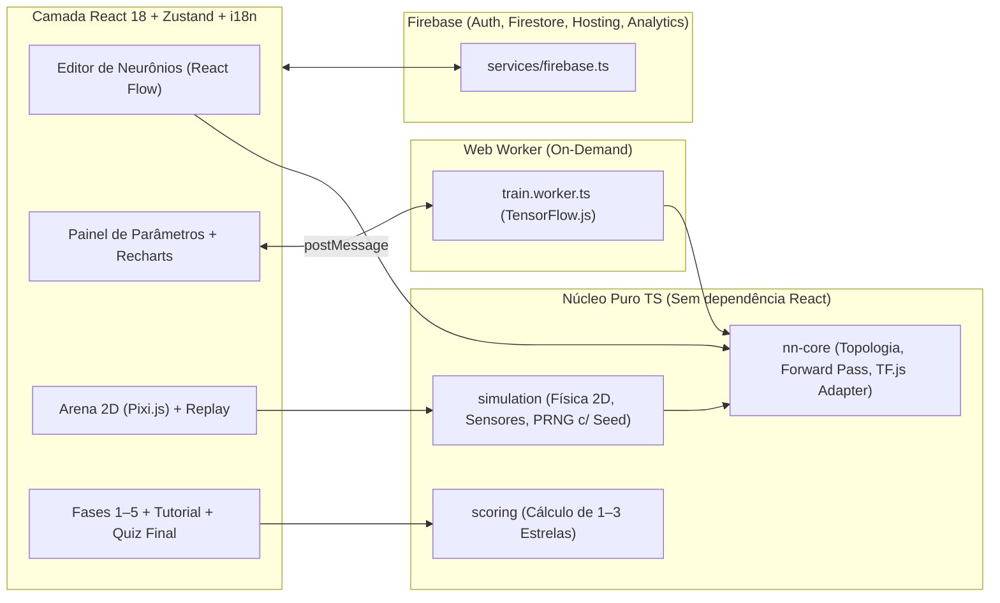

# Plano de Implementação — NeuroBot (SDD T1–T10)

Este plano mapeia a construção completa do jogo web educativo **NeuroBot** seguindo rigorosamente o Software Design Document (`docs/SDD.md`).

> [!IMPORTANT]
> **Fluxo de Execução por Tarefa (`T1` a `T10`)**
> Cada tarefa será executada individualmente e só avançará após:
> 1. Execução de `npm run lint` e `npm test` com 100% de aprovação;
> 2. Verificação visual dos critérios de aceite no navegador com captura de **screenshot**;
> 3. Commit atômico padronizado no formato `T<n>: <resumo>`.

---

## Visão Arquitetural



### Estrutura do Projeto
```text
neurobot/
├── src/
│   ├── core/
│   │   ├── nn-core/        # topologia, forward pass puro TS, conversão TF.js
│   │   ├── simulation/     # robô, sensores, física simples 30 ticks/s, seed determinística
│   │   └── scoring/        # cálculo de estrelas (1 a 3)
│   ├── workers/
│   │   └── train.worker.ts # treino supervisionado (Fases 1–4) e RL/Neuroevolução (Fase 5)
│   ├── features/
│   │   ├── editor/         # editor de neurônios (React Flow, drag-and-drop + atalhos de teclado, hover RF-06)
│   │   ├── params/         # painel de parâmetros, dicas RF-04, gráfico de loss/recompensa (Recharts)
│   │   ├── arena/          # renderização Pixi.js 60 fps + controles 0.5x/1x/4x + replay
│   │   └── levels/         # seleção de fases, tutorial guiado, glossário, quiz final
│   ├── levels/             # 01-first-step.json .. 05-maze.json
│   ├── services/
│   │   └── firebase.ts     # Auth (anônimo + vínculo Google), Firestore, Analytics, suporte a Emuladores
│   ├── store/              # estado global Zustand
│   └── i18n/               # pt-BR.json, en.json + helper de tradução
├── e2e/                    # teste Playwright E2E da Fase 1
├── firebase.json
├── firestore.rules
├── .firebaserc
├── .env.example
├── .github/workflows/deploy.yml
└── docs/SDD.md
```

---

## Mapeamento Detalhado das Tarefas (`T1` a `T10`)

### `T1` — Scaffold do Projeto
- **Escopo**:
  - Inicializar projeto **Vite + React 18 + TypeScript (`strict: true`)**.
  - Configurar **ESLint**, **Prettier**, **Vitest** + **Testing Library** (com cobertura `@vitest/coverage-v8`).
  - Criar a árvore de diretórios da seção 4 (`src/core/{nn-core,simulation,scoring}`, `src/workers`, `src/features/{editor,params,arena,levels}`, `src/levels`, `src/services`, `src/store`, `src/i18n`).
  - Configurar i18n base (`src/i18n/pt-BR.json` e `src/i18n/en.json`) para garantir zero strings fixas nos componentes.
  - Criar `.env.example` documentando as variáveis `VITE_FIREBASE_*`.
- **Critério de Aceite**:
  - `npm run lint` e `npm test` passam sem erros.
  - `npm run dev` abre a tela inicial do NeuroBot no navegador (com screenshot).
- **Commit**: `T1: scaffold do projeto Vite + React + TS e estrutura base`

---

### `T2` — Configuração do Firebase e Segurança
- **Escopo**:
  - Criar `firebase.json` (Hosting apontando para `dist`, rewrite SPA `** -> /index.html`, headers `max-age=31536000, immutable` em `/assets/**` e `no-cache` em `/index.html`, além de portas dos emuladores Auth e Firestore).
  - Criar `firestore.rules` garantindo leitura/escrita apenas quando `request.auth != null && request.auth.uid == uid` em `/users/{uid}/{document=**}`.
  - Criar `.firebaserc` com os ambientes `dev` (`neurobot-dev`) e `prod` (`neurobot-prod`).
  - Implementar `src/services/firebase.ts` com inicialização modular do Firebase Auth (login anônimo e vínculo com Google preservando `uid`), Firestore (com suporte offline e conexão automática aos emuladores locais em modo dev/test) e Analytics.
  - Implementar testes automatizados das regras de segurança (`firestore.rules`) e do fluxo de autenticação anônima.
- **Critério de Aceite**:
  - Login anônimo funciona no emulador;
  - Teste de regras comprova que um `uid` não consegue ler ou escrever documentos de outro `uid`;
  - Verificação no navegador com screenshot mostrando o status de sessão autenticada.
- **Commit**: `T2: configuração Firebase Hosting, Auth, Firestore e testes de regras`

---

### `T3` — Núcleo da Rede Neural (`nn-core`)
- **Escopo**:
  - Implementar `src/core/nn-core/` **sem nenhuma dependência de React**:
    - Tipos de topologia (`Topology`, `NeuronNode`, `ConnectionLink`, `ActivationType`: `step`, `sigmoid`, `relu`, `tanh`, `NetworkWeights`, `TrainingParams`).
    - **Forward pass puro em TypeScript**: calcula e retorna a soma ponderada ($z = \sum w_i x_i + b$) e a saída ativada ($a = \sigma(z)$) de cada neurônio para inspeção em tempo real (RF-06) e execução leve na arena.
    - **Conversão e treino com TensorFlow.js**: construção de grafo/modelo TF.js ou cálculo diferenciável compatível com as ativações (`sigmoid`, `relu`, `tanh`, e suporte a perceptron/degrau nas fases 1–2), inicialização determinística de pesos (seed fixa) e exportação/importação de pesos serializáveis.
  - Testes unitários exaustivos cobrindo forward pass, serialização e convergência para portas `AND`, `OR` e `XOR`.
- **Critério de Aceite**:
  - Testes de unidade para `AND`, `OR` e `XOR` convergem com $\text{loss} < 0{,}05$.
  - Cobertura de testes $\ge 70\%$ no módulo.
- **Commit**: `T3: implementar nn-core com forward pass puro e treino TF.js`

---

### `T4` — Editor Visual de Neurônios
- **Escopo**:
  - Implementar `src/features/editor/` utilizando **React Flow**:
    - Nós customizados para Sensores (até 4 entradas), Camadas Ocultas (até 2 camadas com até 6 neurônios cada) e Ações (até 3 saídas).
    - Respeito estrito aos limites e sensores/ações liberados pela fase atual (RF-03).
    - Cabos customizados onde:
      - **Espessura** representa a magnitude do peso ($|w|$);
      - **Cor + ícone/padrão visual** indica o sinal: **azul + sinal `+` (sólido)** para positivo, **laranja + sinal `−` (tracejado)** para negativo (atendendo WCAG 2.1 AA / RNF-04).
    - Operação completa tanto por **arrastar/clique** quanto por **teclado** (adicionar neurônio, conectar nós, ajustar peso manual nas fases 1–2, remover nó/cabo) (RF-02, RNF-04).
    - Tooltip/inspeção ao passar o mouse ou focar num neurônio exibindo soma ponderada ($z$) e saída da ativação ($a$) em tempo real (RF-06).
    - Exportação/importação exata do formato JSON de `topology` definido na seção 5 do SDD.
- **Critério de Aceite**:
  - Montar a rede `2 → 2 → 1` usando teclado e mouse;
  - JSON exportado bate exatamente com o schema da seção 5;
  - Verificação no navegador com screenshot.
- **Commit**: `T4: editor visual de neurônios com React Flow, acessibilidade e inspeção`

---

### `T5` — Painel de Parâmetros e Treino em Web Worker
- **Escopo**:
  - Implementar `src/features/params/`:
    - Controles validados para taxa de aprendizado ($0{,}001$ a $1{,}0$), épocas ($1$ a $500$), função de ativação (`step`, `sigmoid`, `relu`, `tanh`), inicialização de pesos e chave de bias ligado/desligado (RF-04).
    - Controle de ajuste manual de pesos e bias para as fases 1 e 2.
    - Popover/dica curta ("O que isso faz?") em cada parâmetro (RF-04).
  - Implementar `src/workers/train.worker.ts`:
    - Carregamento sob demanda (lazy import) do **TensorFlow.js** dentro do Web Worker (garantindo bundle principal $< 400\text{ KB}$ gzip — RNF-02).
    - Suporte aos comandos `START`, `PAUSE`, `RESUME`, `RESET`, enviando atualizações de época, loss/recompensa e pesos atualizados para animar os cabos ao vivo (RF-05).
  - Gráfico ao vivo em **Recharts** exibindo a curva de loss (Fases 1–4) ou recompensa por episódio (Fase 5), com indicação visual da meta da fase.
- **Critério de Aceite**:
  - UI mantém 60 fps e permanece responsiva durante 500 épocas de treino;
  - Pausar e retomar preserva os pesos e continua a curva de onde parou;
  - Verificação no navegador com screenshot.
- **Commit**: `T5: painel de parâmetros, Web Worker TF.js e gráfico de loss ao vivo`

---

### `T6` — Arena 2D, Simulação Determinística e Replay
- **Escopo**:
  - Implementar `src/core/simulation/` (**sem dependência de React**):
    - Gerador pseudoaleatório determinístico com seed fixa (`mulberry32`).
    - Loop de simulação discreto a **30 ticks/s** (RF-07).
    - Sensores normalizados conforme tabela da seção 3:
      - `dist_front` ($0$ a $1$, desde fase 1)
      - `floor_light` ($0$ ou $1$, desde fase 2)
      - `dist_left` / `dist_right` ($0$ a $1$, desde fase 3)
      - `target_angle` ($-1$ a $1$, desde fase 4)
    - Ações: `jump` (salta obstáculo baixo), `turn_left` / `turn_right` (gira $15^\circ$/tick), `walk` (avança 1 unidade).
    - Gravação de frames/ticks do episódio para replay determinístico.
  - Implementar `src/features/arena/` com **Pixi.js**:
    - Renderização WebGL a 60 fps interpolando o estado da simulação, exibindo robô, feixes dos sensores ativos, obstáculos, botões/portas e alvo.
    - Controles de velocidade ($0{,}5\times$, $1\times$, $4\times$) e botão de **Replay** do último episódio (RF-07).
- **Critério de Aceite**:
  - Teste automatizado comprova que mesma rede + mesma seed produz exatamente o mesmo resultado e trajetória em 10 execuções consecutivas;
  - Verificação visual da arena e controles de velocidade/replay no navegador com screenshot.
- **Commit**: `T6: simulação determinística 2D, renderização Pixi.js e sistema de replay`

---

### `T7` — Fases 1–5, Sistema de Estrelas, Tutorial Guiado, Glossário e Quiz Final
- **Escopo**:
  - Criar `src/core/scoring/` para cálculo de 1 a 3 estrelas:
    - $\star$ 1 estrela: desafio superado na arena;
    - $\star\star$ 2 estrelas: desafio superado + $\text{loss} \le \text{meta da fase}$ (ou meta de recompensa na fase 5);
    - $\star\star\star$ 3 estrelas: 2 estrelas + número de neurônios usados $\le$ rede ideal da fase.
  - Criar os arquivos JSON estáticos em `src/levels/`:
    1. `01-first-step.json`: Pular caixas quando estiverem perto (Perceptron, $1 \to 1$).
    2. `02-logic-gate.json`: Porta lógica AND / OR com botões no chão (Bias e separação linear, $2 \to 1$).
    3. `03-corridor.json`: Seguir corredor desviando de paredes (Camada oculta e ativação não linear, $3 \to 4 \to 3$).
    4. `04-xor.json`: Porta XOR que abre com exatamente um botão aceso (Backpropagation em multicamadas, $2 \to 2 \to 1$).
    5. `05-maze.json`: Labirinto curto até o alvo (Aprendizado por reforço / recompensa por chegar e penalidade por bater, $4 \to 6 \to 3$).
  - Visualizador de dataset (tabela situação $\to$ ação correta nas fases 1–4).
  - Tutorial guiado passo a passo na primeira abertura de cada fase ("aprenda fazendo, nomeie depois") + **Glossário** acessível a qualquer momento (RF-10) + **Quiz Final de 5 perguntas** sobre os objetivos da seção 1 ao concluir a Fase 5.
- **Critério de Aceite**:
  - Testes automatizados verificam que todas as 5 fases são vencíveis com 3 estrelas usando a rede ideal da seção 3;
  - Verificação no navegador com screenshot.
- **Commit**: `T7: fases 1 a 5, cálculo de estrelas, tutorial guiado, glossário e quiz`

---

### `T8` — Persistência na Nuvem e Vínculo de Conta
- **Escopo**:
  - Sincronização com Firestore seguindo exatamente o schema da seção 5:
    - `users/{uid}` (`displayName`, `createdAt`, `lastLevel`, `totalStars`, `locale`)
    - `users/{uid}/progress/{levelId}` (`stars`, `bestLoss`, `neuronsUsed`, `attempts`, `completedAt`)
    - `users/{uid}/networks/{networkId}` (`levelId`, `name`, `topology`, `weights`, `params`, `savedAt`) com limite de até **10 redes salvas por fase** (RF-09).
  - Fluxo de vínculo de conta anônima ao Google (`linkWithPopup` / fallback seguro) preservando todo o progresso e redes salvas (RF-01).
  - Sincronização offline/online transparente (cache local + Firestore persistence) (RNF-06).
- **Critério de Aceite**:
  - Progresso e redes salvas sobrevivem ao recarregar a página e ao vincular/logar;
  - Limite de 10 redes por fase validado;
  - Verificação no navegador com screenshot.
- **Commit**: `T8: persistência de progresso e redes no Firestore e vínculo Google`

---

### `T9` — Polimento: PWA, Acessibilidade, i18n (`pt-BR`/`en`), LGPD e Analytics
- **Escopo**:
  - Configurar **PWA** (`vite-plugin-pwa`, Web App Manifest, Service Worker com cache de assets e fases para funcionamento offline — RNF-06).
  - Completar e revisar traduções `src/i18n/pt-BR.json` e `src/i18n/en.json` com seletor de idioma no cabeçalho.
  - Implementar os eventos do **Firebase Analytics**: `level_start`, `train_run` (épocas, loss final), `level_complete` (estrelas) e `hint_open`.
  - Aviso de privacidade/LGPD claro e adequado para menores de idade (RNF-05).
  - Auditoria de acessibilidade WCAG 2.1 AA (contraste, `aria-label`, navegação por `Tab`, foco visível) e otimização de code-splitting (bundle inicial $< 400\text{ KB}$ gzip).
- **Critério de Aceite**:
  - Auditoria Lighthouse / verificação técnica $\ge 90$ em Performance, Acessibilidade e Boas Práticas;
  - Bundle inicial verificado $< 400\text{ KB}$ gzip;
  - Verificação no navegador com screenshot.
- **Commit**: `T9: PWA offline, i18n pt-BR/en, eventos Analytics, LGPD e acessibilidade`

---

### `T10` — CI/CD, Teste E2E Playwright e Deploy no Firebase Hosting
- **Escopo**:
  - Criar 1 teste **Playwright E2E** completo automatizando a conclusão da Fase 1 no navegador.
  - Criar workflow `.github/workflows/deploy.yml` com:
    - Execução de `npm run lint`, `npm test` e `npm run build`;
    - Deploy em canal de preview (`FirebaseExtended/action-hosting-deploy`) em Pull Requests;
    - Deploy automático em produção no merge para `main`.
  - Documentar todo o projeto no `README.md` (arquitetura, como rodar localmente, como rodar emuladores, testes unitários/E2E e deploy).
  - Realizar o deploy no Firebase Hosting (caso credenciais/projeto estejam autenticados no ambiente) e validar a URL pública.
- **Critério de Aceite**:
  - Teste E2E Playwright da Fase 1 passa;
  - Pipeline CI/CD validado e `README.md` completo;
  - Deploy no Firebase Hosting verificado (ou instruções/autenticação finalizadas com o usuário).
- **Commit**: `T10: teste E2E Playwright, workflow GitHub Actions e documentação final`
